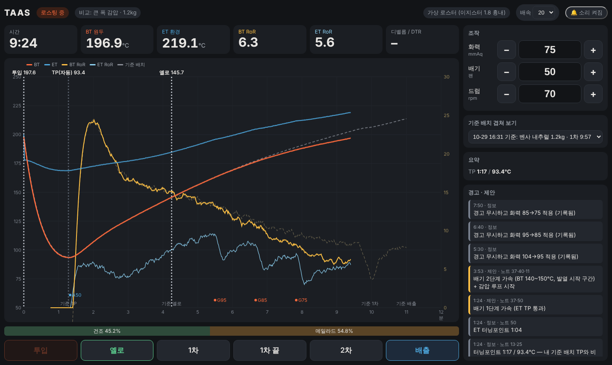

# TAAS — 딘의 로스팅 프로그램 (이지스터 1.8)

로스팅하면서 그래프를 보고, 로스팅 노트 53개에서 뽑은 규칙으로 **지금 해야 할 조작과 하지 말아야 할 조작**을 알려주는 프로그램.
아직 로스터와 연결 전이라 **가상 로스터**로 돌아간다. 실제 연결은 `docs/ROADMAP.md` 1단계.



## 실행 (노트북)
파이썬 3.10 이상만 있으면 됨. 추가 설치 없음, 인터넷 없어도 동작.
```
python -m app.server
```
브라우저에서 **http://localhost:8765** 접속.
- 연습할 땐 `python -m app.server --speed 5` (5배속)
- 화면 오른쪽 위 🔔 를 한 번 눌러야 브라우저가 소리를 켬

## 화면 사용법
1. **예열·BBP**: 화력·배기 입력 후 투입온도가 되면 [투입] → 생두 이름·투입량 입력
2. **로스팅 중**: 화력·배기·드럼은 −/+ 또는 숫자 입력 후 Enter
   - 화력을 내릴 때 RoR이 아직 꺼지는 중이거나 너무 크게 내리면 **확인창**이 뜸 (11·39번 노트)
   - TP·1차는 자동으로 표시되고, 직접 누르면 그걸로 바뀜
   - 경고(빨강, 삑 3번) · 제안(노랑, 삑 1번) · 1차 후보(삑 2번)
3. **[배출]** → 자동으로 BBP 쿨다운(화력 0·배기 최저)으로 전환 → 배출량·색도·컵 메모 입력하면 손실률 계산·저장
4. **[다음 배치]** → 오른쪽 "기준 배치 겹쳐 보기"에서 지난 배치를 고르면 점선으로 겹쳐 보임

## 폴더
```
app/server.py        로컬 서버 (브라우저 화면 제공)
app/session.py       배치 진행·기록·저장
app/sources.py       온도 입력: 가상 로스터 / 실제 로스터(연결 예정)
app/static/          화면
taas_rules/          경고 엔진 + config.json (숫자 기준은 여기서만 고침)
knowledge/           로스팅 노트 53개, 규칙 모음, 색인
batches/             로스팅 기록 (배치마다 JSON 1개)
docs/ROADMAP.md      앞으로 붙일 기능
tests/               테스트: python -m pytest tests
```

## 지금 숫자 기준에 대해
경고 기준은 **주성현 이지스터 1.8 기록 기반 출발값**이다. 딘 머신(프로브 위치·굵기)으로 볶으면서
너무 자주 뜨거나 늦게 뜨는 경고가 있으면 `taas_rules/config.json`의 해당 숫자만 바꾸면 된다.
